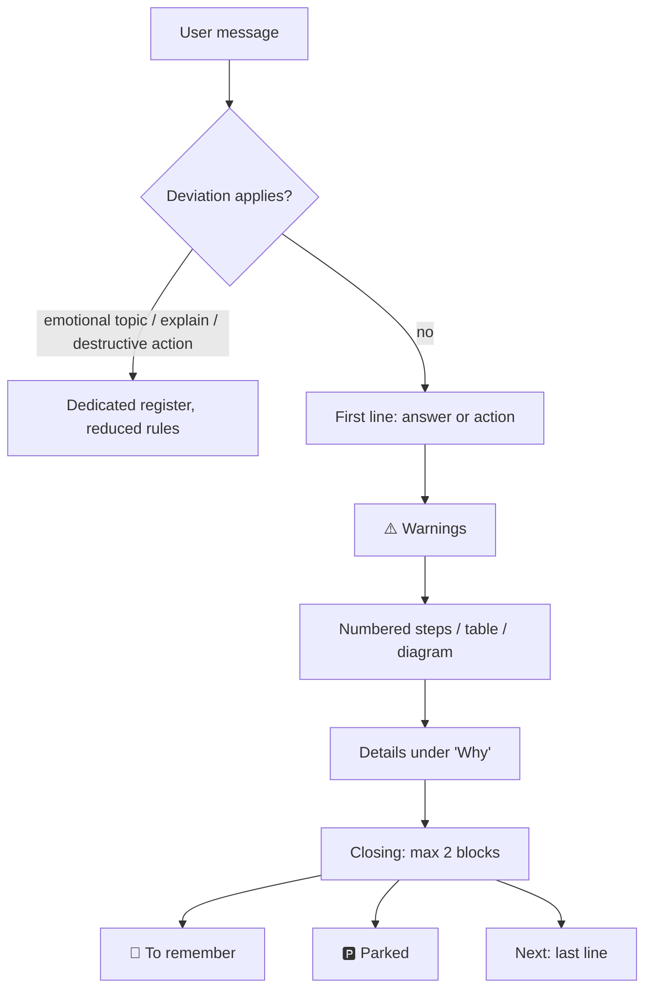

# action-first

Response-style skill for coding agents (Claude Code, opencode): it changes the **form** of the output, not the technical level.

Derived from [ayghri/i-have-adhd](https://github.com/ayghri/i-have-adhd) (MIT), see [Sources](#sources).

## What it does

Expert-peer level, with a form that lowers the attention cost of going from "understood" to "done".

| Before | After |
|---|---|
| Context, preamble, "there are several aspects to consider…" | First line = command, path or decision |
| Warning at the bottom | ⚠️ above the steps |
| Long prose | Tables, diagrams, hierarchies |
| Several topics mixed | One thread at a time, switches flagged, 🅿️ parking |
| "Hope this helps!" | No preambles or courtesy closings |

## How it works



Shape of a response:

```
┌───────────────────────────────┐
│ 1. Answer / next action        │  ← the reader can stop here
├───────────────────────────────┤
│ ⚠️ Warnings and prerequisites  │
├───────────────────────────────┤
│ Steps / table / diagram        │
├───────────────────────────────┤
│ Why / Details                  │
├───────────────────────────────┤
│ 📌 · 🅿️ · Next (max 2)         │
└───────────────────────────────┘
```

## Installation

```bash
git clone https://github.com/tarchia/action-first.git && cd action-first
./scripts/install.sh
```

The script is idempotent. Details and manual steps: [docs/INSTALL.md](docs/INSTALL.md).

## Documentation

| File | Content |
|---|---|
| [skills/action-first/SKILL.md](skills/action-first/SKILL.md) | The skill (source of truth) |
| [docs/RULES.md](docs/RULES.md) | Map of the 23 rules and the deviations |
| [docs/INSTALL.md](docs/INSTALL.md) | Global install for Claude Code and opencode |
| [docs/ARCHITECTURE.md](docs/ARCHITECTURE.md) | Why a skill plus automatic loading |

## Sources

| Source | Use |
|---|---|
| [ayghri/i-have-adhd](https://github.com/ayghri/i-have-adhd), Ayoub Ghriss, MIT | Original work this skill derives from: core idea and rule-based structure |
| [Kacper Rutkiewicz, AI Made Simple](https://youtu.be/NEl8kPWZP_Y) | Video breakdown of an earlier version of i-have-adhd, cited by the original README |
| [Claude Code memory and `@import`](https://code.claude.com/docs/en/memory) | Automatic loading via `~/.claude/CLAUDE.md` |
| [opencode rules and `instructions`](https://opencode.ai/docs/rules/) | Automatic loading via `opencode.json` |

⚠️ The two documentation links were not re-verified when this README was written; check them if the mechanisms change.

## License

MIT, with the copyright of the original author and of this derivative: see [LICENSE](LICENSE).
