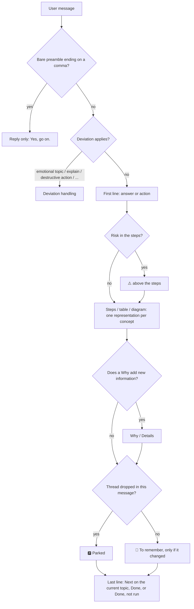

<p align="center">
  
</p>
<p align="center">
  <strong>Full expert depth, ADHD-friendly form. Answer first, no filler.</strong>
</p>
<p align="center">
  <a href="LICENSE"></a>
</p>

Response-style skill for coding agents (Claude Code, opencode): it changes the **form** of the output, not the technical level.

**Twice-exceptional (2e)** describes people with high ability in one or more domains *and* one or more disabilities, such as ADHD, a learning disability or autism ([NAGC position statement](https://assets.noviams.com/novi-file-uploads/nagc/Position_Statements/NAGC_PositionPaper_2E.pdf), after Reis, Baum and Burke 2014). The two can mask each other, so neither is obvious. This skill targets giftedness with ADHD: expert-level understanding, with an attention and executive cost in turning "understood" into "done". Its rules help any reader who wants the answer first.

Derived from [ayghri/i-have-adhd](https://github.com/ayghri/i-have-adhd) by Ayoub Ghriss (MIT); see [Credits and tooling](#credits-and-tooling).

## What it does

Expert-peer level, with a form that lowers the attention cost of going from "understood" to "done".

| Before | After |
|---|---|
| Context, preamble, "there are several aspects to consider…" | First line = command, path or decision |
| Warning at the bottom | ⚠️ above the steps, and only for real risks; guesses are labeled "Hypothesis:" |
| Long prose | Tables, diagrams, hierarchies |
| Several topics mixed | One thread at a time, switches flagged, 🅿️ parking |
| "Hope this helps!" | No preambles or courtesy closings |
| "You could also try…" after every answer | Extras only for real problems; a finished task ends on "Done: …" |
| Re-answering the same question in new words | After the third time: name what would change the answer, offer to build it |
| Agreeing when the user pushes back | Position changes only for a new fact or argument |

## Install

```bash
git clone https://github.com/JohnnyTriggerDev/twice-exceptional-skill.git
cd twice-exceptional-skill
./scripts/install.sh
```

Idempotent; installs for Claude Code and opencode and loads the skill in every session. On Windows: `powershell -ExecutionPolicy Bypass -File scripts\install.ps1`. For claude.ai, manual steps and verification: [docs/INSTALL.md](docs/INSTALL.md).

## Turn it off

| Scope | How |
|---|---|
| Current session | Write "normal mode" or "stop twice-exceptional-skill" |
| Permanently | Remove the loading lines, see [docs/INSTALL.md#disable](docs/INSTALL.md#disable) |

## Examples (TL;DR)

Five invented prompts, same model, with and without the skill. Full replies side by side: [docs/EXAMPLES.md](docs/EXAMPLES.md).

| Prompt | Without the skill | With the skill | Length |
|---|---|---|---|
| Remove a Docker volume that may be in use | A tutorial with three steps and the caveats at the end | `docker ps -a --filter volume=<name>`, then ⚠️ back up first, **above** the steps | 1,759 → 862 (-51%) |
| SQLite or Postgres for ~100 users? | "Probably SQLite", then four long lists and a question back | **"Use SQLite."**, a ⚠️ with the exception, a table of alternatives | 1,966 → 1,392 (-29%) |
| `i want to add caching to the flask api, redis or in memory,` | A two-option guide with a comparison table | **"Use Redis."**, ⚠️ on the per-worker cache, asks "Plan first or execute?" | 3,502 → 1,591 (-55%) |
| A rough call with the manager, thinking of quitting | Empathy, then a list of questions | Empathy, "no need to decide tonight", **one** question | 832 → 408 (-51%) |
| Move cities to be closer to family? | Three blocks of questions and a regret test | No verdict: the two questions that decide it, offers to draft a message to the family | 1,877 → 812 (-57%) |

Five of eight pairs, picked for readability, one run each: a demo, not a measurement. Without the skill a reply is sometimes the more complete one.

## How it works

Always-on through global instructions, not only when the model picks the skill ([docs/ARCHITECTURE.md](docs/ARCHITECTURE.md)).



Shape of a response:

```
┌──────────────────────────────────────┐
│ 1. Answer / next action              │  ← the reader can stop here
├──────────────────────────────────────┤
│ ⚠️ Risks, only if there are any      │
├──────────────────────────────────────┤
│ Steps / table / diagram              │
├──────────────────────────────────────┤
│ Why / Details, only if new           │
├──────────────────────────────────────┤
│ 🅿️ or 📌 (optional) · Next or Done   │
└──────────────────────────────────────┘
```

Across a session: "Now:" when the goal changes, "Back to:" when a parked thread resumes, steps named rather than numbered, and the same term for the same concept ([docs/RULES.md](docs/RULES.md#across-a-session)).

## Rules at a glance

Scope, precedence, 13 rule sections, 7 deviations and a two-line pre-send check, about 2,400 words. Map and tables: [docs/RULES.md](docs/RULES.md). Full text: [SKILL.md](skills/twice-exceptional-skill/SKILL.md).

| Section | What it does |
|---|---|
| Scope | Always on; form proportional to the content (a short answer is two sentences, structure only when the content has that shape); says which skill is active if asked |
| Precedence | Environment instructions, then safety (including crisis language), then deviations, then the rest; nothing suppresses a warning or a confirmation |
| Answer first, Warnings, Structure | Answer or action on the first line with a one-clause reason; ⚠️ above the steps, only for risks; tables and diagrams, one representation per concept |
| One thread, Switches and parking | No extras except real problems; divergent mode; "Now:", "Back to:", 🅿️ Parked |
| Doing, Verification | Do, don't ask, with a side-effect boundary; check with the tools available or mark "Hypothesis:" |
| Input, Progress | Fragments, typos, dates; status, resume points, stop points in long sessions, tedious and avoided tasks |
| Ready-to-use text, Tone, Memory | Texts ready to send; direct, not cold; same terms, 📌 To remember |
| Closing | Last line Next, Done or "Done, not run"; at most one 🅿️ or 📌 block above it |
| Deviations | Emotional topics, explain, destructive action, debug spiral, question loop, ambiguity, options with pros and cons |

## Limits

- Prompt-only: it shapes how the agent writes, and the model can still drift from it. CI checks the docs, the diagrams and both install scripts, not the model's compliance; [success metrics](docs/RESEARCH.md#success-metrics) count corrections in real conversations; one private replay test is summarized in [docs/RESEARCH.md](docs/RESEARCH.md#replay-test).
- System and environment instructions win over the skill (Precedence 1); the form stays.
- Not a mental-health tool: on personal and emotional topics the skill steps aside, and it never presents itself as a substitute for a person.

## Evidence

The cited papers document the risks the rules target: sycophancy, dependence on always-available assistants, generic referrals, and lost context after interruptions. No paper tests these rules as prompts, and none tests the question-loop deviation or the "Done" closing directly. Five of the fourteen papers are arXiv preprints. A separate table lists the ADHD and giftedness papers behind the traits that the strengths rules address. A replay test on one user's real conversations (27 prompts, 3 sessions) preferred the skill in 29 of 30 blind comparisons, with one tie; the judge used the skill as its rubric, so read its limits first. On DeepSeek V4.1 Flash, judged blind by Claude Haiku and GLM, version 7 beats no skill on 40 synthetic ADHD scenarios (32 to 7) and on the i-have-adhd eval suite (weighted 4.27 vs 3.82 with Haiku, 4.63 vs 4.48 with GLM): [benchmarks on other models](docs/RESEARCH.md#benchmarks-on-other-models). Full tables, with each finding, the rule it supports and its limits: [docs/RESEARCH.md](docs/RESEARCH.md).

## Documentation

| File | Content |
|---|---|
| [skills/twice-exceptional-skill/SKILL.md](skills/twice-exceptional-skill/SKILL.md) | The skill (source of truth) |
| [docs/RULES.md](docs/RULES.md) | Map of the rule sections, the deviations and the old rule numbers |
| [docs/INSTALL.md](docs/INSTALL.md) | Global install for Claude Code and opencode |
| [docs/ARCHITECTURE.md](docs/ARCHITECTURE.md) | Why a skill plus automatic loading |
| [docs/EXAMPLES.md](docs/EXAMPLES.md) | Five before/after replies, side by side |
| [docs/RESEARCH.md](docs/RESEARCH.md) | Papers, findings, use and limits |

## Credits and tooling

| Source | Use |
|---|---|
| [ayghri/i-have-adhd](https://github.com/ayghri/i-have-adhd), Ayoub Ghriss, MIT | Original work this skill derives from: core idea and rule-based structure |
| [Kacper Rutkiewicz, AI Made Simple](https://youtu.be/NEl8kPWZP_Y) | Video breakdown of an earlier version of i-have-adhd, cited by the original README |
| [Claude Code memory and `@import`](https://code.claude.com/docs/en/memory) | Automatic loading via `~/.claude/CLAUDE.md` |
| [opencode rules and `instructions`](https://opencode.ai/docs/rules/) | Automatic loading via `opencode.json` |

Both documentation links checked on 17 October 2026: `@path` imports in `~/.claude/CLAUDE.md` and the `instructions` array in `opencode.json` work as described here.

## License

MIT, with the copyright of the original author and of this derivative: see [LICENSE](LICENSE).
