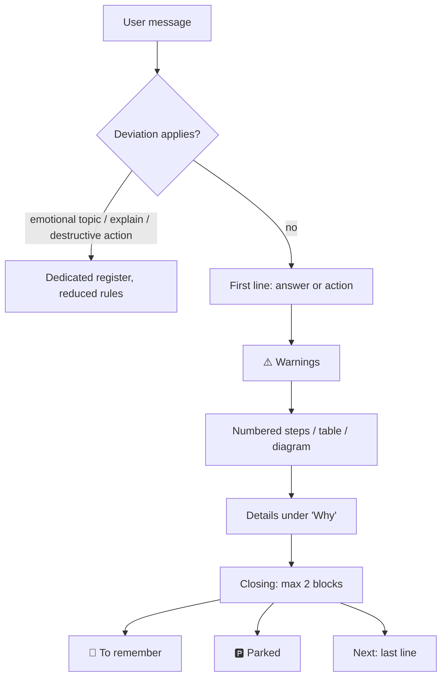

# twice-exceptional-skill

Response-style skill for coding agents (Claude Code, opencode): it changes the **form** of the output, not the technical level.

Derived from [ayghri/i-have-adhd](https://github.com/ayghri/i-have-adhd) (MIT), see [Sources](#sources).

## What it does

Expert-peer level, with a form that lowers the attention cost of going from "understood" to "done".

| Before | After |
|---|---|
| Context, preamble, "there are several aspects to consider…" | First line = command, path or decision |
| Warning at the bottom | ⚠️ above the steps |
| Long prose | Tables, diagrams, hierarchies |
| Several topics mixed | One thread at a time, switches flagged, 🅿️ parking |
| "Hope this helps!" | No preambles or courtesy closings |
| "You could also try…" after every answer | Extras only for real problems; a finished task ends on "Done: …" |
| Re-answering the same question in new words | After the third time: name what would change the answer, offer to build it |
| Agreeing when the user pushes back | Position changes only for a new fact or argument |

## How it works



Shape of a response:

```
┌───────────────────────────────┐
│ 1. Answer / next action        │  ← the reader can stop here
├───────────────────────────────┤
│ ⚠️ Warnings and prerequisites  │
├───────────────────────────────┤
│ Steps / table / diagram        │
├───────────────────────────────┤
│ Why / Details                  │
├───────────────────────────────┤
│ 📌 · 🅿️ · Next (max 2)         │
└───────────────────────────────┘
```

## Installation

```bash
git clone https://github.com/tarchia/twice-exceptional-skill.git && cd twice-exceptional-skill
./scripts/install.sh
```

The script is idempotent. Details and manual steps: [docs/INSTALL.md](docs/INSTALL.md).

## Documentation

| File | Content |
|---|---|
| [skills/twice-exceptional-skill/SKILL.md](skills/twice-exceptional-skill/SKILL.md) | The skill (source of truth) |
| [docs/RULES.md](docs/RULES.md) | Map of the 23 rules and the deviations |
| [docs/INSTALL.md](docs/INSTALL.md) | Global install for Claude Code and opencode |
| [docs/ARCHITECTURE.md](docs/ARCHITECTURE.md) | Why a skill plus automatic loading |

## Sources

### Research (papers only)

| Paper | Finding | Use |
|---|---|---|
| [Carik, Ping, Ding, Rho, "Exploring Large Language Models Through a Neurodivergent Lens: Use, Challenges, Community-Driven Workarounds, and Concerns", Proc. ACM Hum.-Comput. Interact. 9(1), 2025](https://doi.org/10.1145/3701194) | Qualitative coding of Reddit posts from neurodivergent communities: lack of personal voice, false information, overreliance and replacing human connection are recurring concerns | Rule 13, rule 20 exception, emotional-topics deviation |
| [Sharma et al., "Towards Understanding Sycophancy in Language Models", ICLR 2024](https://arxiv.org/abs/2310.13548) | Five assistants tailor feedback and answers to the user's stated views and often abandon correct answers after "Are you sure?" | Rule 21.7, question-loop deviation |
| [Cheng, Lee, Khadpe, Yu, Han, Jurafsky, "Sycophantic AI decreases prosocial intentions and promotes dependence", Science 391(6792), 2026](https://doi.org/10.1126/science.aec8352) | Models affirm users' actions far more than humans; in preregistered experiments, affirming responses lowered willingness to repair a real conflict, yet were rated higher and trusted more | Rule 21.7, emotional-topics deviation |
| [Tang et al., "Beyond the Single Turn: Reframing Refusals as Dynamic Experiences Embedded in the Context of Mental Health Support Interactions with LLMs", FAccT 2026](https://doi.org/10.1145/3805689.3806723) | Surveys and interviews with users and clinicians: generic "seek professional help" endings felt dismissive; both groups preferred tailored, feasible hand-offs that keep engaging | Emotional-topics deviation: once, concretely, then stay |
| [Song, Pendse, Kumar, De Choudhury, "The Typing Cure: Experiences with Large Language Model Chatbots for Mental Health Support", Proc. ACM Hum.-Comput. Interact. 9(7), 2025](https://doi.org/10.1145/3757430) | Interviews (21 users): default recommendations such as "see a therapist" were sometimes out of touch with the user's context | Emotional-topics deviation: fitted to their situation |
| [Salkovskis, Kobori, "Reassuringly calm? Self-reported patterns of responses to reassurance seeking in obsessive compulsive disorder", J. Behav. Ther. Exp. Psychiatry 49, 2015](https://doi.org/10.1016/j.jbtep.2015.09.002) | In anxious groups, reassurance gives short-term relief, then the urge to ask again returns; not in healthy controls. Retrospective self-report | Question-loop deviation (indirect) |
| [Halldorsson, Salkovskis, "Treatment of Obsessive Compulsive Disorder and Excessive Reassurance Seeking in an Older Adult: A Single Case Quasi-Experimental Design", Behav. Cogn. Psychother. 45(6), 2017](https://doi.org/10.1017/S1352465817000376) | Blanket refusal of reassurance may not help; shifting to support was used instead. Single case | Question-loop deviation: answer stands, no refusal, no comment on asking |
| [Lukoff et al., "How the Design of YouTube Influences User Sense of Agency", CHI 2021](https://doi.org/10.1145/3411764.3445467) | Survey (120 users) and co-design: recommendations and autoplay undermine sense of agency; users with a specific goal prefer agency-supporting design | Rule 5.2, "Done" closing (analogy from video apps) |
| [Fang et al., "How AI and Human Behaviors Shape Psychosocial Effects of Extended Chatbot Use: A Longitudinal Randomized Controlled Study", arXiv 2503.17473, 2025 (preprint)](https://arxiv.org/abs/2503.17473) | 4-week RCT (981 completers): no effect of condition; more voluntary daily use associated with more loneliness and emotional dependence, less socialization. Correlational; caps and break nudges proposed, not tested | Rule 5.2, rule 19.2, "Done" closing (motivation) |
| [Phang et al., "Investigating Affective Use and Emotional Well-being on ChatGPT", arXiv 2504.03888, 2025 (preprint)](https://arxiv.org/abs/2504.03888) | Platform analysis of over 3M conversations plus the same RCT as Fang et al.: affective use concentrates in a small tail of very heavy users | Same as Fang et al.; not independent evidence |
| [Cheng et al., "The Slow Drift of Support: Boundary Failures in Multi-Turn Mental Health LLM Dialogues", arXiv 2601.14269, 2026 (preprint)](https://arxiv.org/abs/2601.14269) | LLM-simulated patients against three models: boundary breaches in most dialogues, about half of them definitive guarantees; repeated probing made breaches come earlier. Simulated users and an LLM judge | Emotional-topics deviation: no guarantees; question-loop deviation |
| [Sharma et al., "Who's in Charge? Disempowerment Patterns in Real-World LLM Usage", arXiv 2601.19062, 2026 (preprint)](https://arxiv.org/abs/2601.19062) | 1.5M Claude.ai conversations: severe cases under 1 in 1,000, far higher in relationships than in software work; patterns include sycophantic validation, verdicts on third parties and complete scripts for personal messages that some users sent and regretted | Rule 17 and rule 20 exceptions, rule 21.7, emotional-topics deviation |
| [Parnin, Rugaber, "Resumption strategies for interrupted programming tasks", Software Quality Journal 19(1), 2011](https://doi.org/10.1007/s11219-010-9104-9) | Logs of 10,000 sessions from 86 programmers plus a survey of 414: only 10% of sessions resume editing within a minute of an interruption; developers rebuild context from notes and cues left in the environment | Rule 19.4 |
| [Shah, de Souza Santos, Santos, Magalhaes, Gama, "Extending LLM-based support for software engineers with ADHD", arXiv 2610.00555, 2026 (preprint)](https://arxiv.org/abs/2610.00555) | Tether 2.0, an assistant with planning, coding, debugging and review modes, activity context and persistent memory. Expert survey (16, from a demo video) rated task decomposition highest and completion and sustained focus lowest; one engineer with ADHD used it for two weeks and valued the checklists and resuming after interruptions. Perceived usefulness only, no outcome measures | Rule 19.4, "Done, not run" closing (supporting only) |

No paper tests these rules as prompts, and none tests the question-loop deviation or the "Done" closing directly: the papers show the risks the rules are meant to reduce, not that the rules reduce them. Five of the fourteen are arXiv preprints. Shah et al. 2026 rests on one user and expert opinion on a demo; it supports rule 19.4 and the "Done, not run" closing only together with Parnin and Rugaber and the logic of rule 13. Checked in full text: the five preprints, Carik et al. and Sharma et al. 2024. Checked on the abstract and the relevant sections only: Cheng, Lee et al. (arXiv version 2510.01395), Tang et al., Song et al., Lukoff et al., Parnin and Rugaber, and the two clinical papers.

### Credits and tooling

| Source | Use |
|---|---|
| [ayghri/i-have-adhd](https://github.com/ayghri/i-have-adhd), Ayoub Ghriss, MIT | Original work this skill derives from: core idea and rule-based structure |
| [Kacper Rutkiewicz, AI Made Simple](https://youtu.be/NEl8kPWZP_Y) | Video breakdown of an earlier version of i-have-adhd, cited by the original README |
| [Claude Code memory and `@import`](https://code.claude.com/docs/en/memory) | Automatic loading via `~/.claude/CLAUDE.md` |
| [opencode rules and `instructions`](https://opencode.ai/docs/rules/) | Automatic loading via `opencode.json` |

⚠️ The two documentation links were not re-verified when this README was written; check them if the mechanisms change.

## License

MIT, with the copyright of the original author and of this derivative: see [LICENSE](LICENSE).
