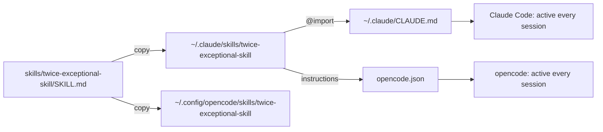

# Architecture

Back to the [README](../README.md). Install steps: [INSTALL.md](INSTALL.md).

A skill alone is invoked only when the model judges it relevant. A style that must apply **always** needs a second channel: global instructions.

| Channel | Guarantees start | Role |
|---|---|---|
| Skill | No, the model decides | Availability on invocation |
| `CLAUDE.md` / `instructions` | Yes | Automatic activation |

The file under `skills/` is the single source of truth: re-run `install.sh` after every change to realign the installed copies.
