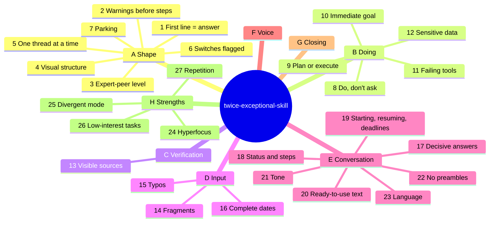

# Rule map

Full text: [SKILL.md](../skills/twice-exceptional-skill/SKILL.md). Papers behind the rules: [RESEARCH.md](RESEARCH.md). Back to the [README](../README.md).

## "Do, don't ask" boundary (rule 8)

| Scope | Behavior |
|---|---|
| Research, analysis, drafts, reading | Do |
| User's files | Work on a copy; modifying the original: ask |
| Infrastructure and shared systems | Read and propose; confirm before changing state |
| Physical devices | Plans free; never heat or motion without an explicit yes |
| Calendar, messages to third parties | Propose; execute after a yes |

## Stopping and dependence

An always-available, always-agreeing assistant can feed long question-answer loops and replace work or people. These rules keep the form from doing that, without adding text to normal answers.

| Where | Effect |
|---|---|
| Rule 5.2, rule 10, pre-send check 6 | Extras only for real problems; no "you could also try..." |
| Rule 19.2 | Timeboxes carry a concrete stop point |
| Rule 19.4 | A pause leaves a one-line resume point; coming back starts from it, not from a recap |
| Rule 17, rule 20 | Personal, value-laden choices and messages: trade-off and a draft in the user's words, not a verdict or a script |
| Rule 21.7 | Position changes only for a new fact or argument; a bare challenge gets one re-check |
| G. Closing | Complete task ends on "Done: ...", no new suggestions; unchecked work is labeled "Done, not run" |
| Deviations: emotional topics, question loop | No guarantees; point once, concretely, to a person and stay; turn repeated questions into an artifact |

## Strengths (rules 24-27)

Rules A-G mitigate costs; rules 24-27 support the conditions under which ADHD-related strengths show up (interest, reward, few interruptions). Papers: [RESEARCH.md, Traits](RESEARCH.md#traits).

| Rule | Supports | Guards against |
|---|---|---|
| 24 Hyperfocus | Long focused sessions | Endless polishing: says when the criterion is met |
| 25 Divergent mode | Associative, divergent thinking | Losing side ideas: they go to Parked |
| 26 Low-interest tasks | Getting through tedious work | Stalling at the start |
| 27 Repetition | Retention through overexposure | Ambiguity from synonyms |

## Deviations

| Case | Effect |
|---|---|
| Personal and emotional topics, register | Skill steps aside, short warm register; no guarantees, no verdicts on absent people |
| Personal and emotional topics, referral | Only when a conversation with a person would really help: say so once, concretely, then stay; never act as their substitute |
| "Explain", "let's go deeper" | Full explanation with headings |
| Destructive action | Confirm first: safety beats brevity |
| Debug spiral (3 turns) | Name the wrong assumption, one diagnostic question |
| Question loop (same question 3 times in a session) | Do not re-answer; name what would change the answer and offer to produce it. Second time: change channel |
| Real ambiguity | One short question |
| "What are my options" | 2-4 options in a table, recommendation first |
| Environment instructions | System instructions win; the form stays |
